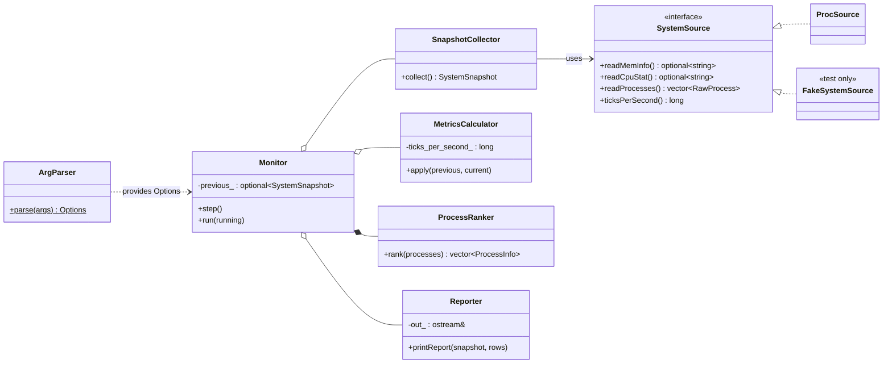
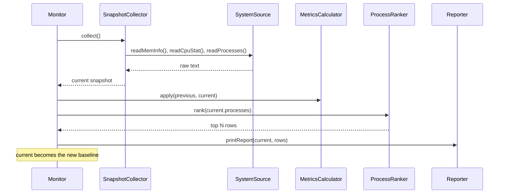

# System Monitor: Refactoring Design

**Team:** Justin Shupe (lead), Aiden Poynor

The monitor already works, but most of it is free functions that read `/proc` directly, and `main.cpp` holds the argument parsing and the main loop. That makes it hard to test since `/proc` changes every time you read it. The plan is to keep the existing structs (`MemoryInfo`, `CpuCounters`, `ProcessInfo`, `SystemSnapshot`) and move the logic into a few classes, with all OS access behind one interface so the rest can be tested with fake data.

## 1. Requirements

| ID | Requirement |
| --- | --- |
| R1 | Read total and available memory from `/proc/meminfo` and compute used memory. |
| R2 | Read the aggregate CPU counters from the first `cpu` line of `/proc/stat`. |
| R3 | List running processes with PID, name, CPU ticks, start time, and RSS. Skip processes that exit or can't be parsed. RSS is optional (kernel threads don't have it). |
| R4 | Compute overall CPU% from two samples. Unavailable if the delta is zero or invalid. |
| R5 | Compute per-process CPU% using the actual elapsed time. Unavailable for new processes or reused PIDs. |
| R6 | Sort by CPU% or memory (descending, unavailable last, ties by PID) and keep the top N. |
| R7 | Parse `--interval`, `--top`, `--sort`, and `--help`. Reject invalid input with exit code 1. |
| R8 | Take a baseline, then report every interval until Ctrl+C. Unavailable values print as `--`. |
| R9 | If `/proc/meminfo` or `/proc/stat` can't be read, print an error and exit with code 1. |

## 2. System Design

### Classes

| Class | Responsibility |
| --- | --- |
| `SystemSource` | Interface for getting raw system data (meminfo text, stat text, process list). |
| `ProcSource` | Linux implementation of SystemSource that reads from `/proc`. |
| `SnapshotCollector` | Uses a source to parse the data and build a `SystemSnapshot` (R1, R2, R3, R9). |
| `MetricsCalculator` | Computes overall and per-process CPU% from two snapshots (R4, R5). |
| `ProcessRanker` | Sorts and trims the process list (R6). |
| `ArgParser` | Turns command line args into an `Options` struct or an error (R7). |
| `Reporter` | Prints a report to an `ostream` (R8). |
| `Monitor` | Runs the baseline / sample / report loop (R8). |

### Relationships

- `ProcSource` inherits from `SystemSource`. In tests, a `FakeSystemSource` will also implement it.
- `SnapshotCollector` uses an `SystemSource&` that it doesn't own.
- `Monitor` uses the collector, calculator, and reporter, and owns its `ProcessRanker`.
- `main()` creates everything and passes it into `Monitor`.



### Key declarations

```cpp
class SystemSource {
public:
    virtual ~SystemSource() = default;
    virtual std::optional<std::string> readMemInfo() = 0;
    virtual std::optional<std::string> readCpuStat() = 0;
    virtual std::vector<RawProcess> readProcesses() = 0;  // comm, stat, status text
    virtual long ticksPerSecond() const = 0;
};

class SnapshotCollector {
public:
    explicit SnapshotCollector(SystemSource& source);
    SystemSnapshot collect();  // throws std::runtime_error on R9 failures
private:
    SystemSource& source_;
};

class MetricsCalculator {
public:
    explicit MetricsCalculator(long ticks_per_second);
    void apply(const SystemSnapshot& previous, SystemSnapshot& current) const;
private:
    long ticks_per_second_;
};

class Monitor {
public:
    Monitor(Options opts, SnapshotCollector& collector,
            const MetricsCalculator& metrics, Reporter& reporter);
    void step();  // collect, compute, rank, print, save as baseline
    void run(const std::atomic<bool>& running);
private:
    Options opts_;
    SnapshotCollector& collector_;
    const MetricsCalculator& metrics_;
    ProcessRanker ranker_;
    Reporter& reporter_;
    std::optional<SystemSnapshot> previous_;
};
```

### How it works

`main()` parses the args with `ArgParser`, creates a `ProcSource`, and passes it into a `SnapshotCollector`. It then builds the `Monitor` and calls `run()`. Each `step()` collects a new snapshot, has `MetricsCalculator` compare it to the previous one, gives the process list to `ProcessRanker`, and sends the result to `Reporter`. The new snapshot then becomes the baseline. If collection throws, `main()` catches it, prints the error, and returns 1.



A couple of small changes make testing easier. `ArgParser` takes a `vector<string>` instead of `argv`. `Reporter` writes to any `ostream`. `MetricsCalculator` gets ticks per second in its constructor instead of calling `sysconf()` itself.

### Design Pattern: Strategy (bonus)

**Problem:** The collectors read hard-coded `/proc` paths, so we can't test them with known input or force edge cases like a reused PID. OS calls are also spread across files (`Metrics.cpp` includes `<unistd.h>`), which would break the Windows build in `build.sh`.

**Pattern:** `SystemSource` is the strategy interface. `ProcSource` and `FakeSystemSource` are the concrete strategies, and `SnapshotCollector` uses whichever one it's given.

**Improvement:** Collection and metrics can be tested with exact input, and all the Linux-specific code lives in one class. Adding Windows support later would just mean writing a new source class.

## 3. Test Design

Unit tests use `FakeSystemSource` with ticks per second set to 100.

| ID | Target | Input / Setup | Expected Result |
| --- | --- | --- | --- |
| T1 | R1 | `MemTotal: 8000`, `MemAvailable: 3000` | used = 5000 |
| T2 | R1, R9 | meminfo missing or has no `MemTotal` | throws |
| T3 | R2 | `cpu 10 20 30 40 50 60 70 80` | all 8 fields parsed |
| T4 | R2, R9 | malformed or empty stat text | throws |
| T5 | R3 | 3 valid fake processes | 3 records with correct values |
| T6 | R3 | process name `my (weird) app` | parsed correctly |
| T7 | R3 | process with no `VmRSS` line | kept, memory shows `--` |
| T8 | R3 | one process with a bad stat line | skipped, others kept |
| T9 | R4 | total 1000 → 1200, idle 800 → 900 | 50.0% |
| T10 | R4 | same counters in both snapshots | unavailable |
| T11 | R5 | ticks 100 → 150 over 1 s | 50.0% |
| T12 | R5 | ticks 100 → 350 over 1 s | 250.0% (multi-core) |
| T13 | R5 | new PID, or same PID with a different start time | unavailable |
| T14 | R6 | CPU% {5, 30, none, 30} | sorted desc, ties by PID, none last |
| T15 | R6 | 20 processes, top 5 | 5 highest rows |
| T16 | R7 | `--interval 2000 --top 5 --sort mem` | those values set |
| T17 | R7 | `--top 0`, `--interval abc`, `--sort disk`, `--top` with no value | error |
| T18 | R8 | `step()` twice with changing fake data | two reports, second compared to first |
| T19 | R8 | run program, press Ctrl+C | refreshes each interval, exits with 0 |

**Coverage:** Every requirement has at least one normal case and one error or edge case. T1 to T18 are unit tests that rely on the fake source for exact input. T19 is a manual check on the real program, since live system values can't be predicted exactly.
